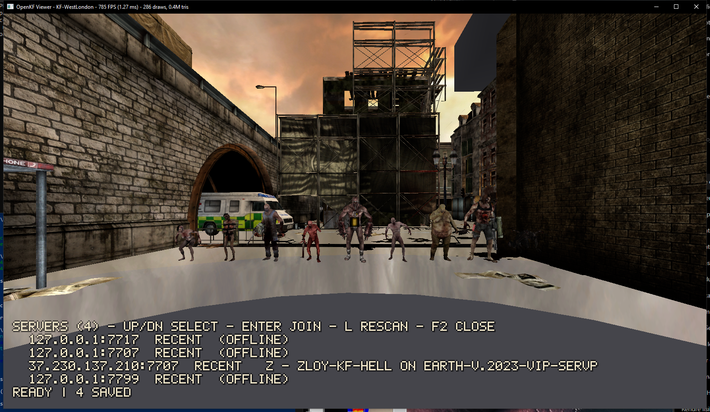
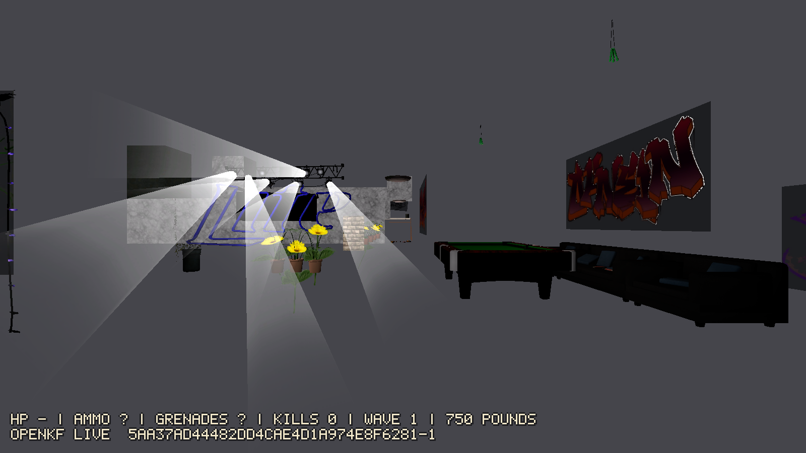

# OpenKF — native 64-bit Killing Floor client

OpenKF is a clean-room, native 64-bit client for Killing Floor v1065 (Unreal
Engine 2.5): it joins real servers, downloads custom content, and renders the
live match with a modern Vulkan renderer. No retail binaries are reused — only
your legally installed game data (maps, meshes, textures, sounds).





## Highlights (v1.9.0)

- **Live multiplayer**: handshake, Steam auth, actor replication, RPCs, movement,
  firing, reloading, grenades, trader purchases, server travel, auto-reconnect.
- **Content downloads**: FastDL (HTTP redirect, `.uz2`), the retail download
  cache (`Cache/Cache.ini`), and in-connection `ChannelDownload` (`CHTYPE_FILE`)
  for maps missing from the redirect — all in the background with a progress bar.
- **Combat effects**: particle bursts (blood, muzzle flash, smoke), surface-
  projected decals, articulated multi-body Karma ragdolls.
- **Sound**: 3D positional audio, nested `SoundGroup`s, 2839/2839 custom
  sounds decode with zero failures.
- **Server browser**: favorites + recents + direct IP with live GameSpy
  details (hostname, map, players), LAN discovery, an internet list via
  the Steam Web API, and an in-viewport overlay (F2) — no console needed.
- **Benchmarks**: headless `--bench` orbit and PresentMon presented-FPS;
  retail vs OpenKF numbers below.

## Performance (real numbers)

Same map (`KF-WestLondon`), 1280x720, 360° orbit. RTX 4060 Ti, Windows 11.
Method + raw data: [docs/BENCHMARKS.md](docs/BENCHMARKS.md).

| Client | Scene | FPS | Map load | Peak RAM | CPU | Threads |
|---|---|---|---|---|---|---|
| OpenKF | solo | 671 | 0.14 s | 713 MB | 11% | 31 |
| OpenKF | live, ~155 actors | 95-99 | 0.14 s | 1085 MB | 2% | 33 |
| Retail v1065 | solo | 120 (hard engine cap) | 3.32 s | 597 MB | 5% | 47 |

Presented FPS (PresentMon, 20 s, windowed live wave combat): OpenKF 236 FPS
average vs retail's 120 FPS hard-capped baseline (proven: fullscreen-exclusive
with `MaxClientFrameRate=400` still reads 120 avg — see
[the proof shot](docs/screenshots/shot-retail-cap.png)).

OpenKF loads maps ~24x faster and uses RAM on par with retail (memory-mapped
packages, shared pool meshes). Live orbit FPS is down from v1.8.0's 201 —
the cost of per-frame articulated ragdolls and projected decals; real play
(narrower frustum than the orbit) stays well above 60 — see the benchmarks
doc for findings and variance notes.

## Requirements

- Windows 10/11 64-bit, Vulkan-capable GPU.
- Killing Floor (retail, v1065) installed — Steam default:
  `C:\Program Files (x86)\Steam\steamapps\common\KillingFloor`.
  Override with `--kf <dir>` or the `KF_DIR` environment variable.
- Rust stable (to build).

## Build

```powershell
cargo build --release -p openkf-viewer
# -> target\release\openkf-viewer.exe
```

GNU toolchain note: scoop's `mingw-winlibs` ships an i686-only `dlltool`
that fails 64-bit import libraries (`invalid bfd target`). Put scoop `gcc`'s
`bin` first in `PATH` before building. MSVC users are unaffected.

## Use

```powershell
# Solo: render a map
openkf-viewer KF-WestLondon --kf "C:\...\KillingFloor"

# Join a server (IP from the browser, a friend, or a listing)
openkf-viewer --connect 127.0.0.1:7717 --play

# Server browser (favorites / recents / LAN / direct)
openkf-viewer --browse

# Headless screenshot + benchmark
openkf-viewer --connect 127.0.0.1:7717 --screenshot shot.png --time 30
openkf-viewer KF-WestLondon --bench 300 --size 1280x720
```

Downloads (FastDL / channel / retail cache) land in
`%LOCALAPPDATA%\OpenKF\Downloads` — never inside the game install.

## Layout

| Crate | Role |
|---|---|
| `openkf-viewer` | Vulkan client: scene, actors, HUD, audio, particles, ragdolls, browser |
| `openkf-network` | UE2 protocol: handshake, replication, downloads, browser queries |
| `openkf-package` | `.u/.utx/.uax/.rom` readers (meshes, textures, sounds, BSP, anims) |
| `openkf-physics` | Collision + Karma rigid-body runtime |
| `openkf-audio` | 3D mixer (HRTF-capable), WAV decode |
| `openkf-netcap` | UDP relay capture tool (protocol research) |
| `openkf-app`, `openkf-world`, … | Engine pillars (VM, world sim, BSP, animation, mesh, render) |

Docs: [HANDOFF](docs/HANDOFF.md) (state + next steps),
[STATUS](docs/STATUS.md) (feature matrix),
[network protocol](docs/network_protocol.md),
[BENCHMARKS](docs/BENCHMARKS.md).

## Scripts

- `scripts/live_test.cmd` — local server + viewer smoke test.
- `scripts/start_test_server.ps1` — local dedicated server (port 7717).
- `scripts/bench.ps1` — full retail-vs-OpenKF benchmark (see above).

## Release

Each release ships `openkf-viewer.exe` (see
[CHANGELOG](CHANGELOG.md)). Checksums are published with the release notes.
No installer: the exe reads the game path from `--kf` / `KF_DIR`.

## Legal

Clean-room reimplementation for interoperability. You need a licensed copy of
Killing Floor; no game content is redistributed. GPL-3.0-or-later, see LICENSE.
